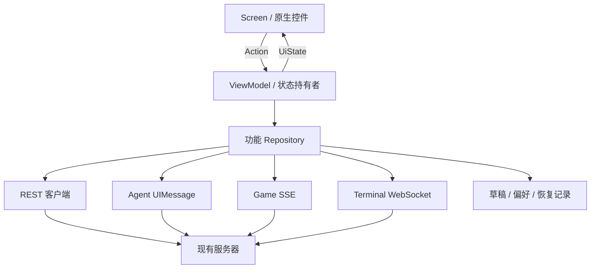

# 02 技术架构与工程设计

本文件为新工程的设计决定。类名和目录是实施指导，实际创建时按职责落实，不要求提前创建空文件。

## 1. 技术选择

| 层 | 选择 | 原因与边界 |
|---|---|---|
| 页面与布局 | Kotlin、Jetpack Compose、单 Activity | 页面状态可显式驱动；布局与视觉参数按 Web 定制 |
| 复杂原生控件 | 必要时使用 AndroidView | 编辑、文字选区和终端绘制在 P1 验证后定实现 |
| 状态 | ViewModel、StateFlow、Coroutines | 页面订阅不可变状态；动作由状态持有者处理 |
| 网络 | OkHttp、kotlinx.serialization | REST、SSE、WebSocket 使用明确协议适配器 |
| 轻量偏好 | DataStore | 连接配置、主题、语言、导航偏好 |
| 草稿与操作记录 | Room | 多文件草稿、命令身份、恢复锚点需要事务与作用域查询 |
| 图片 | 在 P0 选择维护中的原生图片加载库 | 必须支持相同 Cookie、资源作用域与失败状态 |
| 注入 | AppContainer 手动组合 | 初期依赖数量有限；避免引入无实际需要的框架 |
| 构建 | Gradle Wrapper、Version Catalog | 工具链与依赖固定，开发机与 CI 使用相同入口 |

Compose 使用状态向下、事件向上的组织方式，依据 [Android 官方架构指导](https://developer.android.com/develop/ui/compose/architecture)。选用 Compose 不等于使用默认 Material 外观；颜色、圆角、触控区、菜单与动效均由复刻规格约束。

## 2. 工程目录

```text
app/
  src/main/
    AndroidManifest.xml
    java/<application-package>/
      app/                 Application、Activity、依赖组合
      core/
        network/           REST、Cookie、错误、超时、服务器作用域
        agentstream/       UIMessage 解析和投影
        gamestream/        游戏 SSE 解析和投影
        terminal/          WS 传输、原生终端适配
        persistence/       Room、DataStore、草稿与恢复记录
        design/            设计参数、基础组件
        model/             仅真正共用的稳定身份与值类型
      navigation/          目的地、共享顶栏、抽屉与浮层
      feature/
        connection/        服务器输入、认证、配对
        writing/           编辑、文件、保存、审阅
        game/              故事、分支、剧情、状态、恢复
        workbench/         项目、会话、文件、终端、审阅
        lore/              资料库
        plans/             创作方案与关联资源
        market/            资源与扩展管理
        books/             书籍
        versions/          版本
        skills/            Skills
        agents/            Agents
        automations/       自动化
        settings/          设置
        messages/          消息中心
    res/                   中英文资源、字体、矢量、网络配置
  src/test/                协议、保存、状态、fixture 测试
  src/androidTest/         界面、IME、恢复与端到端测试
docs/                      本文档包与开发证据
.github/workflows/         检查与交付流水线
```

保持单模块，按功能 package 隔离所有权。只有真实的编译隔离或团队依赖问题出现时，再记录拆模块决定。公共层只放被多个功能使用且语义一致的能力。

## 3. 调用与所有权



页面只呈现状态并发出用户动作，不在 Composable 函数体、重组或 onResume 中直接创建会话、发送消息和执行写入。连接由对应会话 / 任务状态持有者管理；页面可见性控制订阅，业务任务存活由服务端决定。

Repository 管理 DTO、现有接口、缓存失效和服务端事实；纯状态转换放可测试的 reducer / 投影函数。仅在业务步骤确实复用时提取用例类，避免给每个单行接口增加包装层。

## 4. 稳定身份

```text
ServerKey       = 规范化 scheme + host + port + 部署 basePath
ProjectKey      = ServerKey + ProjectID
DocumentKey     = ProjectKey + 服务器规范相对路径
WritingSession  = ServerKey + SessionID + 基线要求的项目上下文
WorkbenchChat   = ProjectKey + SessionID
GameSession     = ServerKey + StoryID + BranchID
TaskBinding     = 会话作用域 + task_id + operation_id
TerminalOwner   = ServerKey + ClientInstanceID + TabID
```

以上为 Android 内部 key；传输字段仍按现有接口。禁止把显示名、列表下标、当前全局项目指针作为持久身份。所有迟到响应必须匹配请求发出时的作用域与世代标识后才能更新当前页面。

服务器切换时退休网络请求和连接、切换 Cookie 容器及缓存命名空间。不能把 A 服务器的草稿、token、资源 URL、任务游标或权限投射到 B。

## 5. 状态拆分

| 状态 | 所有者 | 保存位置 | 恢复方式 |
|---|---|---|---|
| 项目、文件、消息、任务、权限 | 服务器 | 服务器 | 重新读取对应接口 |
| 文件编辑草稿与基线 | DocumentSession | Room | 与服务端 revision 比较 |
| 未确认的写命令身份 | 会话级 CommandStore | Room | 读取 active / 历史后判断结果 |
| 消息展示投影 | 会话状态持有者 | 内存，最小恢复锚点可持久化 | 历史 + active + 正确的流边界 |
| 页面、选中 ID、标签、滚动 | 页面 / 导航持有者 | SavedStateHandle + 必要的偏好 | ID 有效性验证后恢复 |
| 富文本内存 AST、选区、IME | 编辑器适配器 | 内存；必要选区锚点轻量保存 | 从 canonical Markdown 恢复 |
| 抽屉、菜单、瞬态动画 | 当前界面 | 内存 / rememberSaveable | 恢复后核对焦点与可见层 |
| Cookie / 配对凭证 | 服务器连接作用域 | 密钥保护的凭证存储 | 先读 auth/status |

ViewModel 用于跨配置变化保留状态；进程被回收后，不能依赖内存。SavedStateHandle / rememberSaveable 保存 ID、选择与轻量状态，大文档与消息列表放持久层。依据 [Android 状态保存说明](https://developer.android.com/develop/ui/compose/state-saving)。

## 6. 界面与会话生命周期

写作正文 / Agent 切换时复用同一 DocumentSession 与 ConversationSession。页面隐藏可以停渲染，但不能隐式丢弃草稿、创建新会话或取消远程任务。其他缓存目的地按 Web 的保留行为建立状态。

进入后台：立即把未落盘输入与恢复身份持久化；不把停止收流等同于停止服务端任务。恢复前台：校验认证，读取 canonical 状态，再重建视图与附接。旋转：以稳定 owner 和 key 复用状态，避免重复订阅。

进程重建：读取 ServerKey 和路由身份，先验证连接与登录，再读取实体及 active 状态，最后恢复草稿与游标。实体被删除或权限改变时呈现对应错误，保留可导出的本地草稿。

持续后台保活不是本项目默认前提。若后续需要前台服务或系统通知，必须作为独立产品能力决定；本方案的验收依赖恢复机制。

## 7. 数据与安全的具体要求

CookieJar、受保护图片下载、SSE 与 WebSocket 共用服务器作用域的认证策略。Cookie 遵循 Domain、Path、Secure、过期和服务端 Cookie 名；端口包含在连接身份中。一次性 token 与终端 attach token 不进入日志和分析事件。

Android 访问服务器资源保持规范相对路径和现有 project ID。系统选择器返回的 `content://` 通过字节流上传；不能将手机绝对路径当作服务器文件路径。

Android 9+ 目标应用的明文访问策略需显式配置和验证。P0 根据局域网 HTTP 与 HTTPS 部署需求确定最小网络配置，不关闭 TLS 校验。[官方网络安全配置](https://developer.android.com/privacy-and-security/security-config)

## 8. 必须在 P1 解决的架构问题

1. **编辑器**：用真实语料证明双模式编辑、无修改往返、图片、表格、选区和中文 IME 可达到要求。候选控件的选用结论须附证据。
2. **流协议**：独立的 Agent / Game 解析器完整对应，断线能按服务器身份恢复。
3. **终端**：原生输入、ANSI / VT 屏幕、WS 数据、resize、重连和 owner 生命周期贯通。
4. **权限**：远程允许与本机限定分别复刻，不能依赖新增服务器能力。
5. **跨客户端终端**：Android 只释放本客户端记录的 owner；同时验证 Web 启动时对脱离连接终端的清理行为，见 [07 风险记录](07-evidence-and-decisions.md)。

任一项没有可通过的原生实现时，登记具体缺口和受影响矩阵行。继续完善独立模块可以并行进行，但该项不能被标为完成，也不能在未记录决定的情况下改变原生路线或后端边界。
