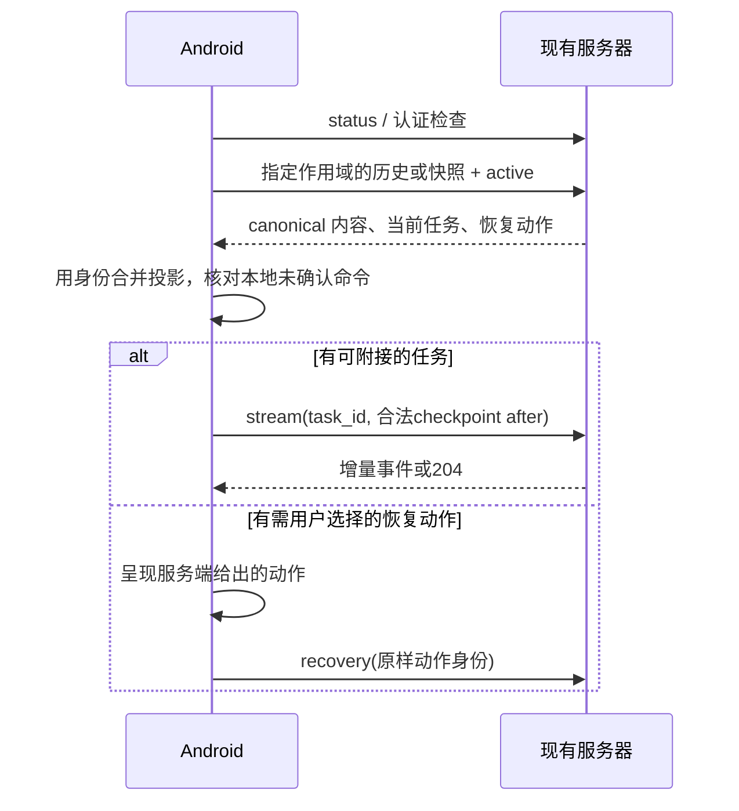

# 03 接口、状态与恢复契约

## 1. 接口使用原则

Android 对现有接口进行独立实现。方法、路径、字段名、空值、默认值、分页、revision 与权限均以固定基线为准。

[API 路由登记说明](api-inventory.md) 指向完整的 [压缩 CSV 清单](api-inventory.full.csv.gz)，其中登记路由方法、完整路径、作用域、注册中间件、handler、来源文件和行号。它覆盖 `routes.go` 的 API 注册与 `remote_access.go` 的认证注册；`/api/platform/manage/*path` 的内部子路由仍需沿平台调用展开。清单不推断 handler 内权限和完整 DTO。

每条被页面使用的接口在实现前补齐：Web 调用位置、请求与响应字段、可空与可省略语义、成功和错误 fixture、认证及权限、缓存键、失效范围、重试条件。新增契约文档附在对应功能目录，链接回矩阵 ID。

## 2. 认证与连接

| 方法与路径 | 用途 | 客户端要求 |
|---|---|---|
| `GET /api/auth/status` | local、authenticated 等连接状态 | 挂载工作台之前读取；登录 / 退出与恢复时刷新 |
| `POST /api/auth/login` | 用户名、密码登录 | JSON 为 `username`、`password`；接受 Set-Cookie |
| `POST /api/auth/pair` | 一次性链接配对 | JSON 为 `token`；已有有效登录则不再消耗 token |
| `POST /api/auth/logout` | 退出并撤销会话 | 成功后退休连接、私有缓存与凭证状态 |
| `POST /api/auth/link` | 生成连接链接 | 服务器本机限定；远程端复刻受限结果 |

流程为：解析服务器地址 → 规范化连接身份 → status → 已认证进入工作台；否则按用户选择登录或消费配对链接 → 复核 status → 读取工作区。

配对 POST 不自动重放。链接中的 token 只保留本次消费所需的短期状态，消费后移除输入与导航历史中的敏感内容。登录失败保留可重试的用户名与服务器地址，不记录密码。

Cookie 名包含服务端端口，具体值由 Set-Cookie 决定。REST、受保护资源、SSE 和 WS 使用同一连接作用域。迟到 401 且要求认证时，先重新查询 status，避免旧响应清除新登录。

原生请求无需伪造浏览器 Origin / Referer；服务器明确处理无这两个头的原生请求。任何连接方式均保持服务端判定的远程权限。

来源：[认证前端](https://github.com/SeraphHsing/denova/blob/671ef4eb609523f07d1c234cdcd242d63ce12652/web/src/features/remote-access/api.ts#L11)、[服务端认证](https://github.com/SeraphHsing/denova/blob/671ef4eb609523f07d1c234cdcd242d63ce12652/internal/api/remote_access.go#L78)、[401 处理](https://github.com/SeraphHsing/denova/blob/671ef4eb609523f07d1c234cdcd242d63ce12652/web/src/lib/api-client/client.ts#L180)。

## 3. 主要接口族

| 业务 | 基础路径 | 需要跟随的语义 |
|---|---|---|
| 书籍 / 当前工作区 | `/api/books*`、`/api/workspace/*` | 选择、排序、导入预览与提交、导出、切换后的缓存 |
| 项目文件 | `/api/projects/:project_id/files/*` | resolve、分页、revision、读 / 写 / 操作、资源 |
| 项目书籍与资料 | `/api/projects/:project_id/book/*` | 章节、lore、材料、审阅与评论 |
| 写作会话 | `/api/sessions*`、`/api/session/*`、`/api/chat*` | 会话管理、消息页、发送、活动任务、控制和恢复 |
| 工作台项目 | `/api/agent-chat/projects*`、`/api/agent-chat/history` | 项目目录、活动与跨项目历史，不隐式切换全局工作区 |
| 项目 Agent | `/api/projects/:project_id/agent-chat/*` | 项目作用域会话、UIMessage 流、消息、提问和恢复 |
| 游戏 | `/api/interactive/stories*`、`/api/interactive/chat*` | story / branch / turn、SSE、状态快照、恢复 |
| 创作资源 | `/api/interactive/tellers*`、`/api/game-planning-templates*`、`/api/event-packages*`、`/api/rule-systems*`、`/api/actor-states*`、`/api/image-presets*` | 每类自己的 DTO、表单和引用关系 |
| 版本与审阅 | 项目下 `/versions*`、`/changes/*` | 计划与提交分开、undo / redo、评论、revision |
| 设置 | `/api/settings*`、项目下 `/settings` | layer、changes、base_revision、部分保存与刷新 |
| Skills / Agents | `/api/skills*`、项目下 `/skills*`；Agents 的配置及会话调用 | 项目与全局边界，不能仅根据资源名称猜测路径 |
| 自动化 / 消息 | `/api/automations*`、`/api/messages*` | 时区、运行、收件箱动作、已读状态 |
| 扩展 | `/api/platform/manage/*path`、`/api/resource-*` | 按方法与子路径判断本机限制，保留远程可用配置 |
| 终端 | 项目下 `/terminal/sessions`、`/api/terminal/sessions*` | 幂等 owner、认证、attach token、二进制与控制帧 |

## 4. 已核对的请求形状

以下示例中的 `PROJECT_ID` 等是说明用变量，不是服务器真实值。字段直接来自固定基线；业务 DTO 中嵌套结构仍需按对应类型展开。

文件保存：

```http
PUT /api/projects/PROJECT_ID/files/file
Content-Type: application/json

{"path":"chapter.md","content":"正文","base_revision":"REVISION"}
```

写作发送：

```http
POST /api/chat
Content-Type: application/json

{
  "session_id":"SESSION_ID",
  "command_id":"COMMAND_ID",
  "message":"输入内容",
  "references":[],
  "lore_references":[],
  "style_scenes":[],
  "selections":[],
  "plan_mode":false
}
```

引用选区字段为 `file_name/start_line/end_line/content`。`ide_context` 需要跟随调用层规范化；`writing_skill/image_preset_id/teller_id` 在选择存在时加入。省略、空数组与空字符串不得随意互换。

工作台发送：

```http
POST /api/projects/PROJECT_ID/agent-chat/chat
Content-Type: application/json

{"command_id":"COMMAND_ID","session_id":"SESSION_ID","message":"输入内容"}
```

可选 `display_message` 用于服务端定义的显示语义。工作台对话不转换成写作的全局发送端点。

游戏发送：

```http
POST /api/interactive/chat
Content-Type: application/json

{"command_id":"COMMAND_ID","mode":"story","story_id":"STORY_ID","branch":"BRANCH_ID","message":"行动"}
```

开场、暂停输入续接、附件及从某轮重生成使用已有的 `start_opening/resume_interruption_id/attachments/regenerate_from_turn_id` 字段；只在相应动作中构造。不得把游戏 Goal 入口加入客户端。

设置保存：

```http
PATCH /api/projects/PROJECT_ID/settings
Content-Type: application/json

{"layer":"LAYER","changes":{},"base_revision":"REVISION"}
```

`LAYER` 需使用服务端 SettingsLayer 的实际枚举，`changes` 需使用已核对字段。全局 target 对应 `/api/settings`。收到部分保存错误时先取消陈旧读取并刷新，再呈现成功文件与失败文件；不能只回滚整个本地表单。

终端创建：

```http
POST /api/projects/PROJECT_ID/terminal/sessions
Content-Type: application/json

{"owner_tab_id":"STABLE_OWNER","profile_id":"PROFILE_ID","cols":80,"rows":24}
```

终端尺寸以实际可用网格计算；80×24 仅为示例。响应提供 session ID 和 attach token，附接到 `/api/terminal/sessions/SESSION_ID/attach?token=TOKEN`。

来源：[写作发送](https://github.com/SeraphHsing/denova/blob/671ef4eb609523f07d1c234cdcd242d63ce12652/web/src/lib/api-client/chat.ts#L16)、[工作台发送](https://github.com/SeraphHsing/denova/blob/671ef4eb609523f07d1c234cdcd242d63ce12652/web/src/features/agent-chat/api.ts#L55)、[游戏发送](https://github.com/SeraphHsing/denova/blob/671ef4eb609523f07d1c234cdcd242d63ce12652/web/src/features/interactive/api.ts#L331)、[设置保存](https://github.com/SeraphHsing/denova/blob/671ef4eb609523f07d1c234cdcd242d63ce12652/web/src/features/settings/api.ts#L70)、[终端](https://github.com/SeraphHsing/denova/blob/671ef4eb609523f07d1c234cdcd242d63ce12652/web/src/features/agent-chat/terminal/api.ts#L38)。

## 5. 两种实时协议

### 5.1 Agent UIMessage

写作与工作台解析 UIMessageChunk。保留 message / part / tool call ID、text、reasoning、文件、来源、metadata、工具输入与结果、审批及业务 data 部件。工具结果采用展开或分页保留完整访问能力。

`data-agent-*` 覆盖 activity、ask、clear、compaction、error、execution summary、image、proposed plan、todo、rule roll、system、token usage、tool result 和 workspace change；P1 从固定类型和投影代码形成逐类型 fixture。未知扩展部件记录类型并保留原始结构，不自动当成最终文本或成功。

消息渲染、tool projection 和 operation 状态分别管理。正在流出的消息与历史分页按稳定身份合并；附接或重新读取不能重复追加相同消息。

### 5.2 Game SSE

传输解析 `event/id/data`，处理 UTF-8 跨包、CRLF / LF / CR、多行 data、注释、空行分帧和 EOF 剩余数据。传输层与游戏事件 reducer 分开。

固定基线有 35 个显式事件，其中 25 个 handled，10 个 ignored。完整列表见 [game-event-contract.csv](game-event-contract.csv)。ignored 表示该游戏舞台投影明确不更新，不能漏登记或当未知错误。

checkpoint、rehydrate、turn persisted、ask、suspended、recovery、done / aborted / error 分别测试。流到达 done 仍需核对 canonical 历史与最终轮次；事件 transport 的结束不自动等于业务成功。

来源：[UIMessage 业务类型](https://github.com/SeraphHsing/denova/blob/671ef4eb609523f07d1c234cdcd242d63ce12652/web/src/lib/agent-ui.ts#L39)、[SSE parser](https://github.com/SeraphHsing/denova/blob/671ef4eb609523f07d1c234cdcd242d63ce12652/web/src/lib/api-client/sse.ts)、[游戏事件表](https://github.com/SeraphHsing/denova/blob/671ef4eb609523f07d1c234cdcd242d63ce12652/web/src/features/interactive/components/story-stage/story-stage-stream-events.ts#L8)。

## 6. 写入与任务状态机

客户端提交状态建议分为 `draft → submitting → accepted / uncertain / rejected`。这是客户端交付状态；服务端的 operation、phase、active、queue、pending_ask 和 recovery projection 保留原字段及语义。

| 事件 | 客户端处理 |
|---|---|
| 接受了明确回执 | 保存 command / operation / task 绑定，跟随服务端投影 |
| 明确业务拒绝 | 展示对应原因，保留输入，按 Web 给出可用动作 |
| 写入后连接断开 | 标记 uncertain，查 active / 历史；不新建 command 重发输入 |
| 已确认的 revision 冲突 | 读取最新版本、三方合并，按保存契约有限重试 |
| 页面切换或旋转 | 只改变订阅与视图归属，不重复提交 |
| 用户停止或暂停 | 对当前 target_operation_id 发送已定义 command |
| 操作已经更换 | 拒绝使用过期目标，刷新状态后重建可用动作 |

同一逻辑命令保持同一 `command_id`。普通 `follow_up/steer/abort/suspend` 控制按各自DTO携带 `target_operation_id`；`steer_queued/cancel_queued` 管理指定的已接受队列项时，同时携带 `target_operation_id` 和该条 `target_command_id`。存在队列本身不改变普通控制命令的字段。`follow_up/steer/next_turn` 按服务器实际允许的动作展示。审批 / 提问按精确 ask ID 解决，记忆规则仅使用服务端声明的作用域与字段。

## 7. 断线恢复



`task_id` 是展示流身份。`stream_cursor` 诊断值、durable journal `cursor` 和合法 SSE `after` 不可互换。`after` 使用服务端 checkpoint 的一次 hand-off；再次断开先重新读取 canonical 状态。204 表示没有可附接流，进入刷新判断流程。

挂接检查的有限等待与 LLM 任务总时长分开。基线部分 active / attach 操作使用 15 秒基础设施等待；不据此给生成任务设置 15 秒终止。

游戏恢复保留 story / branch；`abandon_pending` 仅针对匹配的暂停输入，body 为 `type/story_id/branch_id/resume_interruption_id`。不能把其误用为普通停止。

来源：[任务身份](https://github.com/SeraphHsing/denova/blob/671ef4eb609523f07d1c234cdcd242d63ce12652/web/src/lib/api-client/chat.ts#L173)、[流恢复](https://github.com/SeraphHsing/denova/blob/671ef4eb609523f07d1c234cdcd242d63ce12652/web/src/lib/agent-ui.ts#L151)、[游戏恢复](https://github.com/SeraphHsing/denova/blob/671ef4eb609523f07d1c234cdcd242d63ce12652/web/src/features/interactive/api.ts#L448)。

## 8. 文档保存与并发冲突

DocumentSession 至少保存 `DocumentKey/baseContent/baseRevision/localContent/editGeneration`。同一文档保存串行，不同文档按 key 保留最新待保存值。发送快照与当前编辑内容分离，回执只确认当时快照；期间继续编辑仍为 dirty。

基线默认自动保存延迟为 1500ms，可由现有设置覆盖。外部内容同步不启动新的用户编辑定时器。导航前 flush；不可等待的系统回收首先以本地持久化保留草稿。

revision 冲突时，以 base / local / remote 三方合并。无重叠则按新 revision 继续；基线最多三次保存尝试。有真实重叠时暂停自动保存，保留冲突材料，通过现有 autosave-conflicts 接口及页面动作提供“载入外部版本 / 保留合并结果 / 手动保存”。保存冲突材料失败也必须可见。

网络不明写入结果与已确认的 revision 冲突是不同路径。前者先读回判断，不盲目覆盖；后者允许基线定义的合并后有限提交。

来源：[文件写入](https://github.com/SeraphHsing/denova/blob/671ef4eb609523f07d1c234cdcd242d63ce12652/web/src/lib/api-client/project-files.ts#L154)、[保存队列与合并](https://github.com/SeraphHsing/denova/blob/671ef4eb609523f07d1c234cdcd242d63ce12652/web/src/components/Editor/useEditorDraftPersistence.ts#L121)。

## 9. 终端契约

独立处理 binary PTY 帧与 JSON 控制帧。binary 是原始输出 / UTF-8 输入；文本控制包含 `ready/exit/error/pong`，发送 resize，按基线每 25 秒 ping。WS / WSS 跟随服务器协议，握手同时使用 Cookie 与 attach token。

需要真正的终端屏幕模型支持颜色、光标、清屏、滚屏和全屏程序。可见窗口尺寸改变后重新计算 cols / rows；软键盘、横屏与字号改变均触发必要 resize。

切页和断开 socket 不删除 PTY；显式关闭 owner 才释放。重新连接附接同一会话，重启使用相应关闭与新建流程。关闭操作期间迟到的创建响应仍需检查 owner 存在。

启动清理只作用于本 App 创建且持久记录的 owner；陌生 owner 不作为孤儿释放。浏览器对全局 detached PTY 的清理可能影响 App 会话，必须在 P1 双客户端实测，见 [07](07-evidence-and-decisions.md)。

## 10. 错误与可观测性

解析 HTTP status、`code`、`messageKey` / 本地化字段、details、`request_id` 和 `X-Request-ID`。保留错误 payload 便于语义判断；用户界面采用当前语言的对应文本，日志以英文记录操作、作用域、状态与请求 ID。

传输断开、权限不足、参数错误、revision 冲突和服务端业务失败分别映射。日志不记录密码、Cookie、配对 / attach token、API key 或完整私人正文。实际问题以脱敏日志、请求 ID 和复现数据定位。
