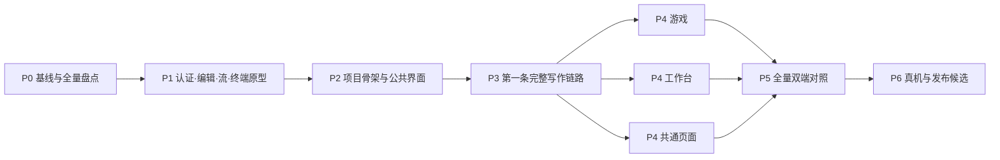

# Denova Android 开发方案：手机 Web 1:1 原生实现

文档日期：2026-10-22。文档状态：开发规划，尚未实施和运行验收。

本方案面向一个全新的 Android 仓库。从项目初始化开始，以 Kotlin 和 Jetpack Compose 实现手机 Web 的界面、操作方式和业务逻辑。后端代码零改动，Android 使用现有认证、REST、实时流和终端协议。

## 1. 项目决定

| 项目 | 本方案决定 |
|---|---|
| 产品目标 | 全部手机 Web 目的地、子页面、浮层、条件入口和业务流程逐项对应 |
| UI 路线 | Kotlin 原生；Compose 组织页面，复杂输入与绘制允许通过 AndroidView 接入原生 View |
| 工程起点 | 新仓库、新构建配置、新源码、新资源、新测试和新 CI |
| 服务端边界 | 通过现有接口访问；不新增接口，不修改后端代码、数据格式和权限规则 |
| 对照基线 | `SeraphHsing/denova@671ef4eb609523f07d1c234cdcd242d63ce12652` |
| 最低系统 | Android 8.0 / API 26；在 P0 锁定 compileSdk、targetSdk 与兼容工具链 |
| 工程组织 | 先建立一个 `app` Gradle 模块，内部按职责组织 package |
| 数据归属 | 服务端为业务事实源；本地保存连接、轻量界面状态、草稿与恢复锚点 |
| 完成定义 | 全量复刻矩阵通过，提供双端操作证据、截图差异、真实服务器及真机结果 |

源码核对只证明基线中定义了相应行为。本轮没有运行 Web、Android 或真实服务器对照；矩阵中的实现与验收状态均从“未开始”起步。

## 2. 1:1 的可执行定义

对照时使用相同服务器版本、权限、项目内容、语言、主题、等效内容宽度、字号和任务初始状态。验收四个方面：

1. **界面**：页面结构、位置、尺寸、间距、图标、颜色、文案、换行、滚动及所有状态对应。
2. **操作**：入口、点击顺序、选择、长按、拖动、抽屉手势、输入、焦点、返回和关闭对应。
3. **逻辑**：前置条件、请求参数、作用域、保存、审批、队列、任务控制、失败与恢复结果对应。
4. **能力边界**：远程手机 Web 可用、禁用、隐藏及需在服务器本机完成的操作，对应呈现。

应用内容区按元素和流程逐项比较。系统状态栏、输入法候选区、系统文件选择器、系统返回手势与字体栅格化单独记录。任何平台差异均需有证据、影响范围和处理结论；不能用一张整体相似度分数替代验收。

## 3. 阅读与执行顺序

| 文档 | 用途 |
|---|---|
| [01 需求与复刻规格](01-product-and-parity.md) | 范围、页面、操作、权限与全量验收规则 |
| [02 技术架构](02-architecture.md) | 工程结构、状态、数据归属、连接和生命周期 |
| [03 接口与状态契约](03-api-and-state.md) | 认证、端点、双流协议、保存、任务恢复、终端 |
| [04 界面与编辑器实施](04-ui-and-editor.md) | 尺寸映射、公共控件、手势、输入、Markdown 与终端实现门槛 |
| [05 开发路线与任务](05-roadmap.md) | 阶段、依赖、任务包、并行分工、阶段退出条件 |
| [06 开发、测试与交付指导](06-development-and-validation.md) | 每日实施流程、测试数据、双端对照、CI、APK 与发布 |
| [07 证据与决策记录](07-evidence-and-decisions.md) | 固定来源、技术决策、待验证项和平台差异 |
| [复刻矩阵（CSV，首批118场景）](parity-matrix.csv) | 唯一维护的场景矩阵；P0继续展开并冻结完整范围 |
| [API 路由登记说明](api-inventory.md) | 完整 API 清单的来源、字段和验证边界 | 
| [完整 API 路由清单（CSV）](api-inventory.csv) | 277 条静态路由注册记录的可读完整版本 |
| [游戏事件清单](game-event-contract.csv) | 固定基线的 handled / ignored 事件分类 |
| [基线元数据](baseline.json) | 仓库提交、来源文件 blob SHA、核对方式与验证状态 |

本目录包含9份Markdown文档（含本总览与API清单说明）、118条首批复刻验收场景、277条静态接口注册记录、35类游戏事件及基线元数据。接口和事件数量来自固定源码提取，场景数量不代表P0已经完成逐字段盘点。

## 4. 开发路线

先完成最容易影响全局路线的原型，再完成一条包含真实数据和失败恢复的写作链路，随后展开其他模块。阶段样例仅用于验证技术；完整产品的范围始终以复刻矩阵为准。

## 5. 第一批必须形成的结果

1. 固定基线的手机 Web 可复现环境、测试账号、数据快照和截图清单。
2. 页面 → 状态 → 操作 → 请求 → 服务端副作用 → 验收证据的追踪关系。
3. 新工程可构建、安装，真实完成连接、认证及 Cookie 复用。
4. Markdown 双模式往返、revision 冲突、两种流恢复、原生终端五项技术门槛的结果。
5. 经原型验证的任务拆分、依赖和验收关卡。已确认先采用里程碑路线，各阶段按退出条件推进；具体日期不作为阶段启动前置条件。

## 6. 立项时需要登记的输入

正式应用名、applicationId、签名归属、分发渠道、目标设备、测试服务器地址及其实际版本，在 P0 登记为具体值。它们尚未在本轮获取，因此本文不提供虚构的安装标识或服务器地址。后续需要日历排期时，再补充团队容量与目标交付日期。

本包可用于开发立项和任务拆分。全量覆盖尚需 P0 将每个页面的实际控件、表单字段及条件分支展开到矩阵；接口登记清单还需追踪 handler 和 Web 调用，不能直接当作请求体文档。
